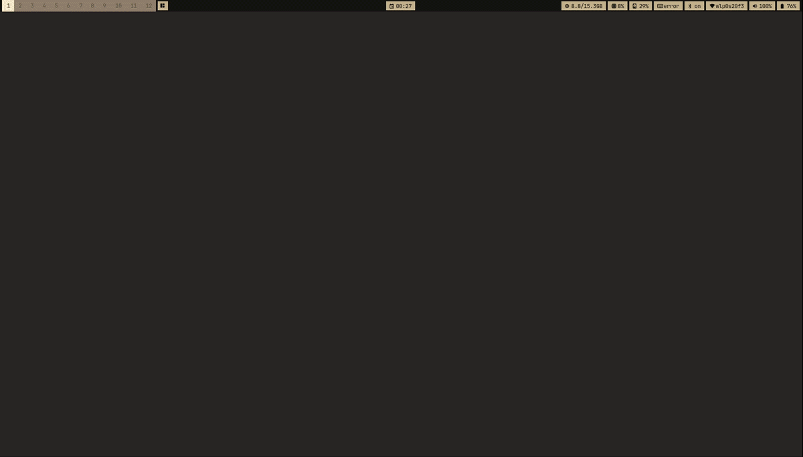

<div align="center">
<a href="https://github.com/nerdyslacker/skarwm"></a>
<p><b>S</b>argsyan <b>KAR</b>en's <b>W</b>indow <b>M</b>anager</p>
</div>

---

<div align="center">

[](https://github.com/nerdyslacker/skarwm/blob/main/LICENSE)
[](https://github.com/nerdyslacker/skarwm/releases)
<a href="https://app.commanddash.io/agent?github=https://github.com/nerdyslacker/skarwm"></a>
[](https://github.com/nerdyslacker/skarwm/stargazers)
[](https://github.com/nerdyslacker/skarwm/fork)

</div>

**skarwm** is a keyboard-driven X11 window manager written in Odin. It arranges
windows in vertical columns on a horizontal strip. Workspaces provide the
vertical dimension. Use the built-in bar, an external panel, or a desktop shell
such as [anush](https://github.com/nerdyslacker/anush).

<div align="center">

</div>

Key features:

- scrolling, stacked, tabbed, dwindle, monocle, game, and floating layouts;
- independent workspaces on each RandR monitor;
- scratchpads, window rules, atomic rc reloads, and Unix-socket IPC;
- EWMH/ICCCM support for docks, pagers, panels, and desktop shells;
- optional bar, titlebars, rounded corners, and layout animation.

[](assets/demo.gif)

## Dependencies

skarwm requires:

- Odin 2026.07 or newer;
- libxcb with the RandR and Shape extensions;
- GNU Make and Clang (used by Odin for linking).

The default build produces the optional `skarwm-bar`, which requires
libX11, libXft, and fontconfig. The commands below install dependencies for the
default build. If your distribution does not package the Odin
language compiler, install it from the
[official Odin releases or source](https://odin-lang.org/docs/install/). On
Debian and Ubuntu, the repository package named `odin` is an unrelated MRI
application and must not be used.

### Void Linux / LazyLinux

Odin is available from the LazyLinux repository:

```sh
printf '%s\n' 'repository=https://github.com/lazylinuxos/lazy-repo/releases/latest/download' \
  | sudo tee /etc/xbps.d/99-repository-lazy.conf
sudo xbps-install -S odin clang make libxcb-devel libX11-devel libXft-devel \
  fontconfig-devel
```

### Debian / Ubuntu

Install Odin separately using the official instructions linked above, then:

```sh
sudo apt update
sudo apt install clang make libxcb1-dev libxcb-randr0-dev libxcb-shape0-dev \
  libx11-dev libxft-dev libfontconfig1-dev
```

### Arch Linux

```sh
sudo pacman -S --needed odin clang base-devel libxcb libx11 libxft fontconfig
```

### Alpine Linux

Install Odin separately using the official instructions linked above. Alpine
Edge users may instead install the `odin` package from the testing repository.
Then install the remaining dependencies:

```sh
sudo apk add clang make musl-dev libxcb-dev libx11-dev libxft-dev \
  fontconfig-dev
```

### Chimera Linux

Install Odin separately using the official instructions linked above, then:

```sh
sudo apk add clang gmake libxcb-devel libx11-devel libxft-devel \
  fontconfig-devel
```

### Gentoo

Install Odin separately using the official instructions linked above, then:

```sh
sudo emerge --ask dev-build/make llvm-core/clang x11-libs/libxcb \
  x11-libs/libX11 x11-libs/libXft media-libs/fontconfig
```

### Fedora

Install Odin separately using the official instructions linked above, then:

```sh
sudo dnf install clang make libxcb-devel libX11-devel libXft-devel \
  fontconfig-devel
```

### openSUSE

Install Odin separately using the official instructions linked above, then:

```sh
sudo zypper install clang make libxcb-devel libX11-devel libXft-devel \
  fontconfig-devel
```

### Solus

Install Odin separately using the official instructions linked above, then:

```sh
sudo eopkg install -c system.devel
sudo eopkg install clang libxcb-devel libx11-devel libxft-devel \
  fontconfig-devel
```

### NixOS

Start a temporary development shell containing the compiler and libraries:

```sh
nix-shell -p odin gnumake clang xorg.libxcb xorg.libX11 xorg.libXft fontconfig
```

### BSDs

Odin supports FreeBSD, OpenBSD, and NetBSD on their supported 64-bit
architectures. Install Odin from the official releases or build it from source.
Use `gmake` instead of the BSD `make` when building skarwm.

#### FreeBSD

Clang is included in the base system:

```sh
sudo pkg install gmake libxcb libX11 libXft fontconfig
```

#### OpenBSD

Install the X11 file sets (`xbase`, `xshare`, and `xfont`) with the operating
system, then install GNU Make. Clang is included in the base system:

```sh
doas pkg_add gmake
```

#### NetBSD

With pkgin configured:

```sh
sudo pkgin install clang gmake libxcb libX11 libXft fontconfig
```

### Runtime and test dependencies

Required at runtime:

- an X11 server and `libxcb` with RandR support;
- a terminal or launcher configured in the rc file. `$TERMINAL` is preferred,
  with `xterm` as the fallback.

Optional test dependencies are Xvnc, xterm, xdotool, xwininfo, xrandr, xprop,
python-xlib, and wmctrl. Nested testing uses Xephyr.
On Void Linux, install them with:

```sh
sudo xbps-install -S tigervnc xterm xdotool xwininfo xrandr xprop \
  python3-xlib wmctrl xorg-server-xephyr
```

## Recommended companion software

These programs add common desktop features:

- [picom](https://picom.app/): compositor and transparent drag overlay
- [rofi](https://github.com/davatorium/rofi): application launcher and window
  switcher
- [maim](https://github.com/naelstrof/maim): screenshots
- [dunst](https://dunst-project.org/): notification daemon
- [kitty](https://sw.kovidgoyal.net/kitty/): terminal
- [feh](https://feh.finalrewind.org/): wallpaper and image viewer
- [betterlockscreen](https://github.com/betterlockscreen/betterlockscreen):
  screen lock
- [brightnessctl](https://github.com/Hummer12007/brightnessctl): backlight
  controls
- [PipeWire](https://pipewire.org/) with WirePlumber, or
  [PulseAudio](https://www.freedesktop.org/wiki/Software/PulseAudio/): audio
- [anush](https://github.com/nerdyslacker/anush): desktop shell for skarwm

skarwm runs without these programs. `assets/example.rc` contains commented
autostart commands and bindings; enable the programs installed on your system.

## Build and install

```sh
make
sudo make install
```

The install target adds `skarwm`, `skarwm-msg`, `skarwm-session`, the display
manager entry, and the example configuration. Session integration files are
kept under `assets/`.

Development commands:

```sh
make debug
make test
make xephyr
make xephyr-multi
```

See [Architecture](docs/architecture.md) for the source tree and runtime flow.

## Configuration

Copy the example configuration and start skarwm:

```sh
mkdir -p ~/.config/skarwm
cp assets/example.rc ~/.config/skarwm/skarwm.rc
skarwm
```

skarwm reloads the file after each save and keeps the active configuration when
the new file contains an error. See [Configuration](docs/configuration.md) for
the search order, imports, settings, bindings, rules, and bar blocks.

For `startx`, copy `assets/xinitrc.example` to `~/.xinitrc`. Display managers
can use the installed `skarwm.desktop` entry.

Common default controls:

- `Super+h/j/k/l`: focus left/down/up/right;
- `Super+Control+h/l`: make the focused column narrower/wider;
- `Super+Control+k/j`: make the focused stacked row shorter/taller;
- `Super+Shift+h/j/k/l`: move within or between columns;
- `Super+1` … `Super+9`: switch workspace;
- `Super+Shift+1` … `Super+Shift+9`: send the focused window;
- `Super+n/p`: next/previous workspace;
- `Super+Control+n/p`: send to the next/previous workspace;
- `Super+Space`: toggle floating;
- `Super+t`: toggle tabbed mode for the focused column;
- `Super+g`: cycle the workspace layout;
- `Super+/`: show all configured skarwm keybindings;
- `Super`+wheel: scroll the workspace strip;
- `Super+,/.`: focus the previous/next monitor;
- `Super+Shift+,/.`: move the focused window between monitors;
- middle-click: maximize/restore a managed window within its usable work area;
- `Super`+left-drag: move a floating window or reposition a tiled window; tiled
  drags show a half-window target overlay;
- `Super+Alt`+left-drag: drop a tiled window onto another one to make it the
  active tab in that window's column;
- `Super`+left-drag on a tab header: reorder the complete tabbed column;
- `Super`+right-drag: resize a floating window or the nearest tiled split;
- hover a narrow edge preview: reveal and focus the adjacent hidden window;

Tabbed mode affects only the focused column. Move windows into it with
`Super+Shift+h/l`, select tabs with `Super+k/j`, and reorder them with
`Super+Shift+k/j`. Press `Super+t` again to split the group back into columns.

The commented [assets/example.rc](assets/example.rc) contains the full binding
set, settings, rules, and autostart examples.
An optional [Rofi configuration and X11 helper bundle](assets/config/README.md)
provides matching launchers for wallpapers, windows, bookmarks, saved scripts,
Wi-Fi, and session power actions.

## IPC and shell integration

[IPC](docs/ipc.md) documents commands, queries, events, scratchpads, and socket
selection. See [Scratchpads and overview](docs/scratchpads-and-overview.md) for
the default scratchpad bindings.

The [documentation index](docs/README.md) covers layouts, scrolling, outputs,
appearance, the bar, and X11 integration.

## Inspiration

The window-management design was inspired by:

- [tonybanters/oxwm](https://github.com/tonybanters/oxwm)
- [Mr-Emacs/nwm](https://github.com/Mr-Emacs/nwm)
- [mangowm/mango](https://github.com/mangowm/mango)
- [mister-grimm96/swaystation](https://github.com/mister-grimm96/swaystation)
