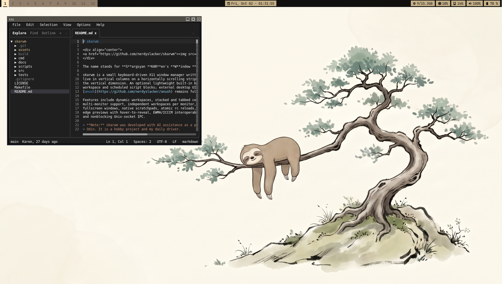

<div align="center">
<a href="https://github.com/nerdyslacker/skarwm"></a>
</div>

---

<div align="center">
<p><b>S</b>argsyan <b>KAR</b>en's <b>W</b>indow <b>M</b>anager.</p>
</div>

**skarwm** is a small keyboard-driven X11 window manager written in Odin. Windows
live in vertical columns on a horizontally scrolling strip, with workspaces as
the vertical dimension. An optional lightweight built-in bar provides
workspace and scheduled script blocks; external desktop UI such as
[anush](https://github.com/nerdyslacker/anush) remains fully supported.

Features include dynamic workspaces, stacked and tabbed columns, Xinerama
multi-monitor support, independent visible workspaces per monitor, floating and
fullscreen windows, native scratchpads, atomic rc reloads, window rules,
edge previews with hover-to-reveal, EWMH/ICCCM interoperability, dock struts,
and nonblocking Unix-socket IPC.

> **Note:** skarwm was developed with AI assistance as a project for learning
> Odin. It is a hobby project and my daily driver.

<div align="center">

</div>

## Dependencies

skarwm requires:

- Odin 2026.07 or newer;
- libxcb with the RandR and Shape extensions;
- GNU Make and Clang (used by Odin for linking).

The default build also produces the optional `skarwm-bar`, which requires
libX11, libXft, and fontconfig. The commands below install dependencies for the
complete default build. If your distribution does not package the Odin
language compiler, install it from the
[official Odin releases or source](https://odin-lang.org/docs/install/). On
Debian and Ubuntu, the repository package named `odin` is an unrelated MRI
application and must not be used.

### Void Linux

Odin is available from the LazyLinux repository:

```sh
printf '%s\n' 'repository=https://github.com/lazylinuxos/lazy-repo/releases/latest/download' \
  | sudo tee /etc/xbps.d/99-repository-lazy.conf
sudo xbps-install -S odin clang make libxcb-devel libX11-devel libXft-devel \
  fontconfig-devel
```

### Debian / Ubuntu

Install Odin separately using the official instructions linked above, then:

```sh
sudo apt update
sudo apt install clang make libxcb1-dev libxcb-randr0-dev libxcb-shape0-dev \
  libx11-dev libxft-dev libfontconfig1-dev
```

### Arch Linux

```sh
sudo pacman -S --needed odin clang base-devel libxcb libx11 libxft fontconfig
```

### Gentoo

Install Odin separately using the official instructions linked above, then:

```sh
sudo emerge --ask dev-build/make llvm-core/clang x11-libs/libxcb \
  x11-libs/libX11 x11-libs/libXft media-libs/fontconfig
```

### Fedora

Install Odin separately using the official instructions linked above, then:

```sh
sudo dnf install clang make libxcb-devel libX11-devel libXft-devel \
  fontconfig-devel
```

### openSUSE

Install Odin separately using the official instructions linked above, then:

```sh
sudo zypper install clang make libxcb-devel libX11-devel libXft-devel \
  fontconfig-devel
```

### Solus

Install Odin separately using the official instructions linked above, then:

```sh
sudo eopkg install -c system.devel
sudo eopkg install clang libxcb-devel libx11-devel libxft-devel \
  fontconfig-devel
```

### NixOS

Start a temporary development shell containing the compiler and libraries:

```sh
nix-shell -p odin gnumake clang xorg.libxcb xorg.libX11 xorg.libXft fontconfig
```

### BSDs

Odin supports FreeBSD, OpenBSD, and NetBSD on their supported 64-bit
architectures. Install Odin from the official releases or build it from source.
Use `gmake` instead of the BSD `make` when building skarwm.

#### FreeBSD

Clang is included in the base system:

```sh
sudo pkg install gmake libxcb libX11 libXft fontconfig
```

#### OpenBSD

Install the X11 file sets (`xbase`, `xshare`, and `xfont`) with the operating
system, then install GNU Make. Clang is included in the base system:

```sh
doas pkg_add gmake
```

#### NetBSD

With pkgin configured:

```sh
sudo pkgin install clang gmake libxcb libX11 libXft fontconfig
```

### Runtime and test dependencies

Required at runtime:

- an X11 server and `libxcb` with RandR support;
- a terminal or launcher configured in the rc file. `$TERMINAL` is preferred,
  with `xterm` as the fallback.

Optional test dependencies are Xvnc, xterm, xdotool, xwininfo, xrandr, xprop,
python-xlib, and wmctrl. Interactive nested testing additionally uses Xephyr.
On Void Linux, install them with:

```sh
sudo xbps-install -S tigervnc xterm xdotool xwininfo xrandr xprop \
  python3-xlib wmctrl xorg-server-xephyr
```

At runtime skarwm links libxcb plus its RandR and Shape extensions. No shell,
bar, compositor, or notification daemon is required; `skarwm-bar` is optional.

## Recommended companion software

skarwm deliberately provides window management rather than a complete desktop.
These optional programs cover common session features:

- [picom](https://picom.app/) — X11 compositing, shadows, fading, and true
  transparency for elements such as the drag/drop overlay
- [rofi](https://github.com/davatorium/rofi) - window switcher, application launcher and not only
- [maim](https://github.com/naelstrof/maim) - utility that takes screenshots of your desktop
- [dunst](https://dunst-project.org/) — lightweight notification daemon
- [kitty](https://sw.kovidgoyal.net/kitty/) — GPU-accelerated terminal
- [feh](https://feh.finalrewind.org/) — image viewer commonly used to set the
  X root-window wallpaper
- [betterlockscreen](https://github.com/betterlockscreen/betterlockscreen) —
  configurable screen-lock wrapper
- [brightnessctl](https://github.com/Hummer12007/brightnessctl) — hardware
  backlight controls
- [PipeWire](https://pipewire.org/) with WirePlumber, or
  [PulseAudio](https://www.freedesktop.org/wiki/Software/PulseAudio/) — desktop
  audio and media-key volume controls
- [anush](https://github.com/nerdyslacker/anush) — shell crafted for full desktop experience on skarwm

None is required by skarwm. Commented autostart commands and bindings for each
are available in `assets/example.rc`; enable only the programs installed on
your system.

## Build and install

```sh
make
make debug
make test
sudo make install
```

The install target adds `skarwm`, `skarwm-msg`, `skarwm-session`, the display
manager entry, and the example configuration. Session integration files are
kept under `assets/`.

Run a standalone nested session with `make xephyr`, or use
`make xephyr-multi` for two RandR monitor objects.

## Source layout

The source is split into small packages with one-way dependencies:

```text
src/
├── main.odin          executable entry point
├── bar/               optional standalone EWMH dock/bar client
├── core/              model, layout, operations, IPC types, pure math
├── x11/               low-level XCB, properties, and RandR bindings
├── input/             keysyms, modifiers, actions, and resolved bindings
├── rendering/         geometry animation and rounded window shapes
├── ui/                tabs, help, and drag/drop overlays
├── process/           detached command launching
├── log/               logging
└── wm/                runtime orchestration, config, EWMH, outputs, IPC server
cmd/skarwm-msg/        standalone IPC command client
tests/core_tests/      X-independent core regression suite
```

See [docs/architecture.md](docs/architecture.md) for the package dependency map,
runtime flow, module responsibilities, and suggested reading order.

The [documentation index](docs/README.md) links concise guides for layouts,
bindings, scrolling, workspaces, scratchpads, visuals, and X11 integration.

## Configuration

The configuration search order is `skarwm -c FILE`, `$SKARWM_CONFIG`, then
`skarwm.rc` in `$XDG_CONFIG_HOME/skarwm`, `~/.config/skarwm`, and
`/etc/skarwm`. At each location the legacy `config.rc` name is used only when
`skarwm.rc` is absent. If no file is found, built-in defaults are used.
Reloading is atomic: an invalid file is reported while the previous
configuration stays active.

Start with the documented example:

```sh
mkdir -p ~/.config/skarwm
cp assets/example.rc ~/.config/skarwm/skarwm.rc
skarwm
```

Large configurations may be split into optional imports. Relative paths are
resolved from the file containing the directive, and imported files participate
in atomic hot reloads:

```text
import : config.d/keybindings.rc
import : config.d/rules.rc
```

Client corners can be rounded with `corner_radius : N`; `0` keeps them square,
and fullscreen windows and bars are never clipped. Layout transitions are
enabled by default (`animations : true`) with a 180 ms
ease-out-cubic curve at a 60 FPS target. `animation_duration_ms`,
`animation_fps`, and `animation_easing` (`linear` or `ease_out_cubic`) are
reloadable; disabling animations applies geometry immediately and schedules no
frames. See `assets/example.rc` for the complete settings.

For `startx`, copy `assets/xinitrc.example` to `~/.xinitrc`. Display managers
can use the installed `skarwm.desktop` entry. 

Default interaction highlights:

- `Super+h/j/k/l`: focus left/down/up/right;
- `Super+Control+h/l`: make the focused column narrower/wider;
- `Super+Control+k/j`: make the focused stacked row shorter/taller;
- `Super+Shift+h/j/k/l`: move within or between columns;
- `Super+1` … `Super+9`: switch workspace;
- `Super+Shift+1` … `Super+Shift+9`: send the focused window;
- `Super+n/p`: next/previous workspace;
- `Super+Control+n/p`: send to the next/previous workspace;
- `Super+Space`: toggle floating;
- `Super+t`: toggle tabbed mode for the focused column;
- `Super+g`: cycle the workspace through Scrolling Tile, Dwindle/Fibonacci, Monocle, and Floating;
- `Super+Ctrl+Alt+h`: show or hide the keybindings help overlay;
- `Super+Ctrl+Alt+t`: show local date and time in a temporary notice;
- `Super+Ctrl+Alt+b`: show battery percentage and charging state;
- `Super+Ctrl+r`: open the countdown reminder editor;
- `Super+Ctrl+Alt+r`: show all pending reminders;
- `Super+Ctrl+Shift+r`: clear all pending reminders;
- `Super+/`: show all configured skarwm keybindings;
- `Super`+wheel: scroll the workspace strip;
- `Super+,/.`: focus the previous/next monitor;
- `Super+Shift+,/.`: move the focused window between monitors;
- middle-click: maximize/restore a managed window within its usable work area;
- `Super`+left-drag: move a floating window or reposition a tiled window; tiled
  drags show a half-window target overlay;
- `Super+Alt`+left-drag: drop a tiled window onto another one to make it the
  active tab in that window's column;
- `Super`+left-drag on a tab header: reorder the complete tabbed column;
- `Super`+right-drag: resize a floating window or the nearest tiled split;
- hover a narrow edge preview: reveal and focus the adjacent hidden window;

Tabbed mode affects only the focused column. Move windows into it with
`Super+Shift+h/l`, select tabs with `Super+k/j`, and reorder them with
`Super+Shift+k/j`. Press `Super+t` again to split the group back into columns.

The fully commented [assets/example.rc](assets/example.rc) documents settings,
bindings, workspace rules, window rules, and autostart commands.

### Jumping to matching windows

A `focus` call jumps to a managed window matching one or more metadata fields,
switching to its output and workspace. Criteria are case-sensitive substring
matches, use AND semantics when combined, and repeated presses cycle through
the matches in stable management order:

```text
# Jump between URxvt windows whose title contains VIM.
call : mod + a : focus class URxvt title VIM

# Quotes preserve spaces in a criterion value.
call : mod + m : focus title "Music Player"
call : mod + i : focus instance thunderbird
```

Supported fields are `class`, `instance`, and `title`. Dock windows and hidden
scratchpads are excluded.

### Scratchpads

skarwm has native, session-only scratchpad registers. Hidden windows remain
managed but leave the tiled layout and are parked off-screen. The first toggle
assigns the focused window; later toggles hide it or summon it on the currently
focused workspace and monitor:

```text
call : mod + grave : scratchpad_toggle 1
call : mod + Shift + grave : scratchpad_toggle_float 2
call : mod + Control + grave : scratchpad_remove 1
```

Registers disappear when skarwm exits, and closing an application clears its
registrations. IPC can also address static groups by X11 app ID, class,
instance, or title:

```sh
skarwm-msg scratchpad target appid kitty
skarwm-msg scratchpad target title "Music Player"
skarwm-msg scratchpad target-float class Pavucontrol
skarwm-msg scratchpad target appid kitty --spawn kitty
```

When matching windows are hidden, the command summons all of them; otherwise
it hides them. `--spawn COMMAND` starts the application when no window matches.

## IPC and shell integration

[docs/IPC.md](docs/ipc.md) documents commands, queries, events, scratchpads,
and socket selection. Desktop shells should communicate through this interface
without becoming dependencies of the WM.

## Inspiration

The window-management design was inspired by:

- [tonybanters/oxwm](https://github.com/tonybanters/oxwm)
- [Mr-Emacs/nwm](https://github.com/Mr-Emacs/nwm)
- [mangowm/mango](https://github.com/mangowm/mango)
